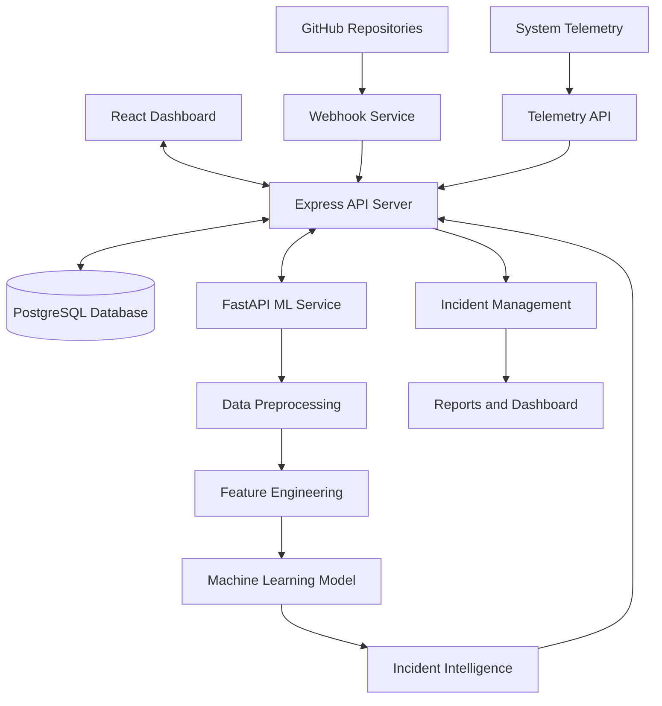
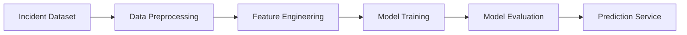
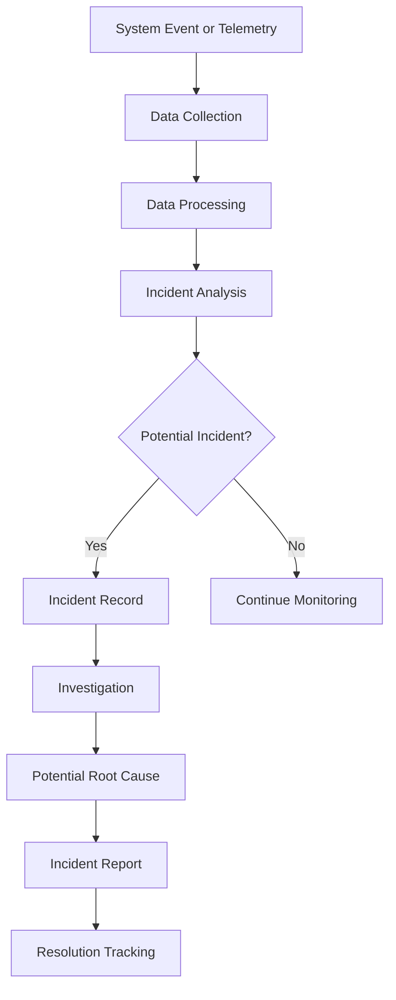

<div align="center">

# 🛡️ IncidentIQ

### AI-Powered Incident Intelligence & Observability Platform

**Detect. Analyze. Understand. Resolve.**

*Formerly known as SentinelAI*


</div>

---

## 📌 Overview

**IncidentIQ** is an AI-powered incident intelligence platform designed to help software engineering teams monitor system activity, identify operational anomalies, investigate incidents, and understand potential root causes.

The platform combines machine learning, telemetry processing, GitHub integrations, incident management, and centralized observability within a unified application.

IncidentIQ explores the principles of **Artificial Intelligence for IT Operations (AIOps)** by combining traditional software engineering with intelligent incident analysis.

---

## 🎯 Problem Statement

Modern software systems generate large volumes of operational data, application logs, repository events, and performance metrics.

Engineering teams often face challenges such as:

- Delayed detection of system failures.
- Difficulty identifying the root cause of incidents.
- Fragmented monitoring and debugging tools.
- Manual incident investigation.
- Limited visibility into application health.
- Time-consuming incident documentation.

IncidentIQ aims to simplify this process through centralized monitoring, machine learning, and intelligent incident management workflows.

---

## ✨ Core Platform Capabilities

| Module | Description |
|--------|-------------|
| 📊 Observability Dashboard | Centralized operational insights |
| 📡 Telemetry Processing | Collect and process system metrics |
| 🚨 Incident Management | Track and investigate system incidents |
| 🧠 Machine Learning | Explore anomaly and incident classification |
| 🔍 Root Cause Analysis | Assist in identifying potential failure causes |
| 🔗 GitHub Integration | Connect repositories and process webhook events |
| 📄 Incident Reports | Structure incident investigation reports |
| 🔐 Authentication | Secure user and integration management |
| 📚 Knowledge Retrieval | Experimental context retrieval for incident analysis |

The platform is actively evolving. Some intelligence and automation capabilities remain experimental or under development.

---

## 🏗️ System Architecture



---

## 🤖 Machine Learning Pipeline

IncidentIQ explores supervised machine learning for incident classification and operational intelligence.

The experimental training pipeline uses a Random Forest model and synthetic incident data.



### Machine Learning Concepts

- Data collection and preprocessing.
- Feature engineering.
- Supervised learning.
- Classification algorithms.
- Random Forest.
- Model evaluation.
- Anomaly detection concepts.
- Prediction service integration.

### Model Development

Random Forest is used as an experimental classification approach because it combines multiple decision trees to improve prediction stability.

The model development workflow focuses on:

- Preparing structured incident datasets.
- Extracting meaningful operational features.
- Training classification models.
- Evaluating model performance.
- Integrating validated models with the backend.

Production-ready prediction serving and validation against real operational datasets are ongoing development objectives.

---

## 🔄 Incident Processing Workflow

The intended end-to-end incident workflow is:



---

## 🔗 GitHub Integration

IncidentIQ includes a GitHub integration layer designed to connect software repositories with incident management workflows.

The integration architecture covers:

- GitHub repository management.
- Webhook event processing.
- Repository persistence.
- Webhook delivery tracking.
- Encrypted integration credentials.
- Repository-linked incident workflows.

Sensitive integration credentials are designed to be protected using AES-256-GCM encryption.

---

## 🛠️ Technology Stack

### Frontend

| Technology | Purpose |
|------------|---------|
| React | Interactive dashboard |
| TypeScript | Type-safe frontend development |
| Vite | Development and build tooling |
| Tailwind CSS | Responsive user interface |

### Backend

| Technology | Purpose |
|------------|---------|
| Node.js | Backend runtime |
| Express.js | REST API development |
| TypeScript | Type-safe backend services |
| Pino | Structured application logging |

### Artificial Intelligence & Machine Learning

| Technology | Purpose |
|------------|---------|
| Python | Machine learning development |
| FastAPI | ML service API |
| Scikit-learn | Model training and evaluation |
| Random Forest | Experimental incident classification |

### Database & Integrations

| Technology | Purpose |
|------------|---------|
| PostgreSQL | Persistent relational storage |
| Drizzle ORM | Database schema and queries |
| GitHub API | Repository integration |
| Webhooks | Event-driven communication |
| AES-256-GCM | Integration credential encryption |

---

## 📂 Repository Structure

```text
IncidentIQ/
│
├── artifacts/
│   ├── web/
│   │   └── Frontend application
│   │
│   ├── api-server/
│   │   ├── src/
│   │   │   ├── controllers/
│   │   │   ├── routes/
│   │   │   ├── services/
│   │   │   └── tests/
│   │   └── Backend API
│   │
│   └── ml_service/
│       └── Python ML service
│
├── lib/
│   └── db/
│       └── src/
│           └── schema/
│
├── scripts/
│   └── Database and migration utilities
│
└── README.md
```

---

## 🚀 Getting Started

### Prerequisites

- Node.js
- Python 3
- PostgreSQL
- Git
- Repository-compatible package manager

### 1. Clone the Repository

```bash
git clone https://github.com/JatinxKumar/IncidentIQ.git
cd IncidentIQ
```

### 2. Configure the Application

Configure the required environment variables for:

- PostgreSQL database connection.
- Backend server port.
- Authentication configuration.
- ML service connection.
- GitHub integration credentials.

Use the environment configuration required by the individual services.

Never commit sensitive credentials or `.env` files to version control.

### 3. Install Dependencies

Install JavaScript dependencies using the package manager specified by the repository lockfile.

Install Python dependencies using the dependency configuration inside the ML service.

### 4. Initialize the Database

Configure PostgreSQL and execute the repository's database migration scripts.

### 5. Start Application Services

Start the following services using their respective development scripts:

- React frontend.
- Express backend.
- FastAPI machine learning service.

The frontend communicates with the backend API, which coordinates database operations and ML service requests.

---

## 🔐 Security Considerations

The platform architecture incorporates the following security principles:

- Secure authentication workflows.
- Encrypted integration credentials.
- Environment-based secret management.
- Database relationship constraints.
- Webhook delivery tracking.
- Controlled access to user-specific integrations.

---

## 💡 Real-World Applications

IncidentIQ is designed around practical engineering use cases:

- DevOps and Site Reliability Engineering.
- Application performance monitoring.
- Software incident investigation.
- GitHub repository observability.
- Operational anomaly detection.
- AI-assisted troubleshooting.
- Incident documentation and reporting.

---

## 🎓 Engineering & Learning Outcomes

This project brings together several computer science and software engineering concepts:

- Artificial Intelligence and Machine Learning.
- Supervised classification.
- Data preprocessing and feature engineering.
- REST API architecture.
- Service-oriented system design.
- Event-driven communication.
- Relational database management.
- Secure third-party integrations.
- Full-stack application development.
- Observability and incident management.

---

## 🔮 Future Roadmap

- [ ] Production-ready ML inference pipeline.
- [ ] Real-world incident dataset validation.
- [ ] Advanced anomaly detection.
- [ ] Semantic knowledge retrieval using real embeddings.
- [ ] AI-assisted root cause analysis.
- [ ] Real-time infrastructure monitoring.
- [ ] Automated incident correlation.
- [ ] Slack and Microsoft Teams integrations.
- [ ] Automated remediation recommendations.
- [ ] Advanced deployment and observability integrations.

---

## 🤝 Contributing

Contributions and constructive feedback are welcome.

1. Fork the repository.
2. Create a feature branch.
3. Implement your changes.
4. Test the implementation.
5. Submit a pull request.

---

## 👨‍💻 Developer

**Jatin Kumar**

Computer Science Engineering Undergraduate

Passionate about full-stack engineering, artificial intelligence, machine learning, and scalable system design.

[](https://github.com/JatinxKumar)
[](https://www.linkedin.com/in/JatinxKumar/)
[](https://jatin-dev.vercel.app)

---

<div align="center">

### Turning Operational Data into Actionable Intelligence.

⭐ Star this repository if you find the project interesting.

**Engineering intelligent systems for more reliable software.**

</div>
